# Arquitectura del Sistema - Plataforma de Machine Learning y Riesgo Sísmico Territorial Santander

## 1. Visión General de la Solución
El sistema está diseñado como un pipeline modular, reproducible y escalable orientado a la ingesta de datos sismológicos oficiales en tiempo real e históricos, ingeniería de características geoespaciales y demográficas, modelado no supervisado multienfoque (K-Means, DBSCAN, GMM, Jerárquico), interpretabilidad mediante reducción de dimensionalidad (PCA), y generación de un Índice Compuesto de Riesgo Sísmico Territorial (ICRST) visualizado en un prototipo interactivo para la toma de decisiones.

---

## 2. Diagrama de Arquitectura de Extremo a Extremo (Pipeline End-to-End)

```mermaid
flowchart TD
    subgraph S1["1. Fuentes Oficiales de Datos"]
        A1["SGC / RSNC Catálogo Sísmico Nacional (FDSN WS)"]
        A2["USGS Earthquake Hazards Program (API GeoJSON)"]
        A3["DANE Censo Nacional y Proyecciones Demográficas"]
        A4["IGAC & SGC Mapa Geológico y Microzonificación"]
    end

    subgraph S2["2. Pipeline ETL y Calidad de Datos (data_pipeline.py)"]
        B1["Ingesta Automatizada (2004 - 2026 Santander BBOX)"]
        B2["Control de Duplicados e Imputación Técnica (RMS, GAP, NST)"]
        B3["Filtrado de Consistencia Geofísica (Z: 0-300km, M: 2.0-9.0)"]
        B4["Almacenamiento de Datos Crudos (data/raw/sismos_santander_raw.csv)"]
    end

    subgraph S3["3. Capa de Feature Engineering Geocientífico"]
        C1["Física: Energía Gutenberg-Richter (E = 10^(4.8+1.5M))"]
        C2["Geodesia: Haversine a Nido Los Santos y Área Metrop. Bucaramanga"]
        C3["Atenuación: Proxy de Aceleración Pico del Terreno (PGA en g)"]
        C4["Enjambre: Densidad Temporal Móvil de Sismicidad (30 días / 35 km)"]
        C5["Dataset Maestro Enriquecido (32 Variables Justificadas)"]
    end

    subgraph S4["4. Zoo de Modelos No Supervisados (unsupervised_models.py)"]
        D1["Preprocesamiento: Estandarización Z-Score (StandardScaler)"]
        D2["K-Means (k=4 óptimo por Codo e Índice Silhouette)"]
        D3["DBSCAN (eps=1.85, min_samples=8) - Detección de Ruido/Enjambres"]
        D4["Gaussian Mixture Models (GMM) - Covarianzas Elipsoidales Benioff"]
        D5["Clustering Jerárquico Aglomerativo (Enlace Ward)"]
    end

    subgraph S5["5. Validación Cuantitativa e Interpretabilidad (PCA)"]
        E1["Métricas de Agrupamiento: Silhouette, Davies-Bouldin, Calinski-Harabasz"]
        E2["PCA (3 Componentes Principales - 74.6% Varianza Explicada)"]
        E3["Análisis de Cargas Factoriales (Feature Loadings e Importancia)"]
        E4["Perfilado Físico-Tectónico de Clusters"]
    end

    subgraph S6["6. Motor de Riesgo Territorial (territorial_risk.py)"]
        F1["Subíndice de Amenaza Física (Energía, PGA, Sismos Superficiales)"]
        F2["Subíndice de Exposición Demográfica (Población DANE Santander)"]
        F3["Subíndice de Vulnerabilidad Geotécnica y Tipología Constructiva"]
        F4["Cálculo del Índice Compuesto ICRST (Escala 0 a 100)"]
    end

    subgraph S7["7. Prototipo Interactivo y Demostración (Web & Notebook)"]
        G1["Dashboard Web Interactivo (Leaflet, Mapas de Calor, Filtros en Vivo)"]
        G2["Cuaderno Jupyter Reproducible (notebooks/analisis_sismico_santander_medio.ipynb)"]
        G3["API Local Ligera (app.py) para demostración a los jurados (Sala 315A)"]
    end

    S1 --> S2
    S2 --> S3
    S3 --> S4
    S4 --> S5
    S5 --> S6
    S6 --> S7
```

---

## 3. Descripción Detallada de los Módulos de la Arquitectura

### Módulo 1: Extracción y Consistencia Oficial (`src/data_pipeline.py`)
- **Protocolo de Conexión:** Consume el endpoint FDSN estándar internacional (`earthquake.usgs.gov/fdsnws/event/1/` sincronizado con la Red Sismológica Nacional de Colombia del SGC).
- **Manejo de Errores e Idempotencia:** Reintentos automáticos, verificación de hash, eliminación de duplicados temporales por microsegundos y validación del polígono de Santander ($5.7^\circ \text{N} \le \text{Lat} \le 8.2^\circ \text{N}$; $-74.5^\circ \text{W} \le \text{Lon} \le -72.4^\circ \text{W}$).

### Módulo 2: Feature Store Geocientífico y Demográfico
- Transforma los datos brutos en 32 variables sismológicas, geodésicas y de ingeniería de suelos.
- Enlaza cada coordenada sísmica con el municipio de Santander más cercano mediante distancia geodésica ortodrómica (*Haversine*), integrando datos de población del DANE y fallas geológicas del SGC.

### Módulo 3: Motor de Modelado No Supervisado (`src/unsupervised_models.py`)
- **Comparación Rigurosa:**
  - **K-Means:** Centroides esféricos que separan la sismicidad por energía y profundidad.
  - **DBSCAN:** Agrupamiento basado en densidad que clasifica 100 eventos como ruido tectónico/anomalías corticales y aísla los núcleos de enjambres.
  - **GMM:** Captura geometrías gaussianas orientadas que modelan la losa subducida de Bucaramanga.
  - **Clustering Jerárquico:** Árbol de similitud por enlace Ward.
- **Validación Multimétrica:** Comparación simultánea de *Silhouette Score*, *Davies-Bouldin Index* y *Calinski-Harabasz Index*.
- **Interpretabilidad:** Proyección PCA con 74.62% de varianza explicada y extracción de las cargas factoriales de cada variable.

### Módulo 4: Motor de Riesgo Territorial (`src/territorial_risk.py`)
- Pasa del "agrupamiento abstracto" a la **explicación cuantitativa del riesgo**:
  $$ICRST = 0.40 \cdot \text{PeligroFísico} + 0.35 \cdot \text{ExposiciónDANE} + 0.25 \cdot \text{VulnerabilidadSuelo}$$
- Explica la paradoja geológica: Los Santos y Aratoca tienen la máxima frecuencia (>800 sismos a ~155 km), pero el Área Metropolitana de Bucaramanga y Barrancabermeja tienen el mayor riesgo por combinación de población crítica, fallas corticales activas superficiales y suelos amplificadores.

### Módulo 5: Capa de Presentación y Prototipo Reproducible
- **Frontend / Dashboard (`web/index.html` + `web/app.js` + `web/styles.css`):**
  - Mapa dinámico de Santander con Leaflet.
  - Capas de calor (Heatmaps) de sismicidad y marcadores coloreados por Cluster / Nivel de Riesgo.
  - Selector en vivo de algoritmos (K-Means vs DBSCAN vs GMM).
  - Selector de municipios de Santander con ficha técnica del ICRST.
  - Gráficos interactivos de dispersión Magnitud vs Profundidad y PCA 2D.
- **Backend / Demostración Local (`app.py`):**
  - Servidor HTTP ligero con endpoints REST `/api/sismos`, `/api/metricas`, `/api/riesgo` para ejecutar localmente en la sala 315A.
